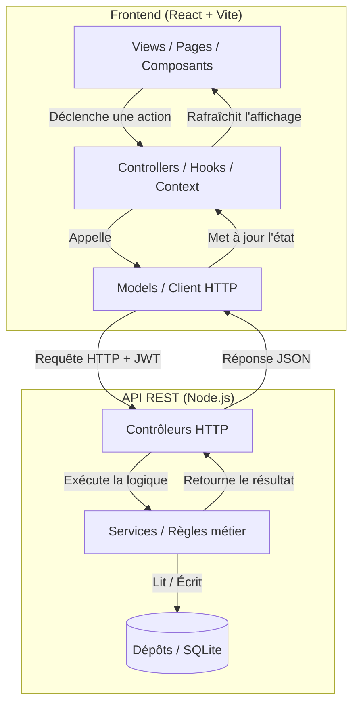

# Architecture des Modules Front-end et Back-end

Ce document décrit l'architecture technique de l'application Mon Miam Miam, organisée selon le patron de conception MVC (Modèle-Vue-Contrôleur), décliné à la fois côté serveur et côté navigateur.

## 1. Principe du Double MVC

L'application est séparée en deux parties distinctes qui communiquent via une API REST :

### Côté Serveur (Backend - Node.js / TypeScript)
L'API est organisée en trois couches distinctes :
- **Contrôleurs** (`controllers/`) : les routes HTTP qui reçoivent les requêtes, valident les données d'entrée, invoquent les services et formatent la réponse JSON.
- **Services** (`services/`) : les règles métier pures, les calculs, les validations. C'est le "modèle" au sens métier.
- **Dépôts** (`repositories/`) : l'accès brut aux données SQLite. Un dépôt par sujet (menu, commandes, comptes...), seul à écrire du SQL.

### Côté Navigateur (Frontend - React / Vite / TypeScript)
- **Modèle** : Le dossier `models/` qui contient les types TypeScript et les fonctions d'appel à l'API (client HTTP centralisé gérant les tokens et les erreurs).
- **Contrôleur** : Les `controllers/` (hooks React et Contextes) qui gèrent l'état local, les effets de bord (appels API via les modèles) et la logique d'interaction.
- **Vue** : Le dossier `views/` (pages et composants UI) qui se contente d'afficher les données fournies par les contrôleurs et de déclencher des actions, sans jamais appeler `fetch` directement.

## 2. Schéma d'Architecture

