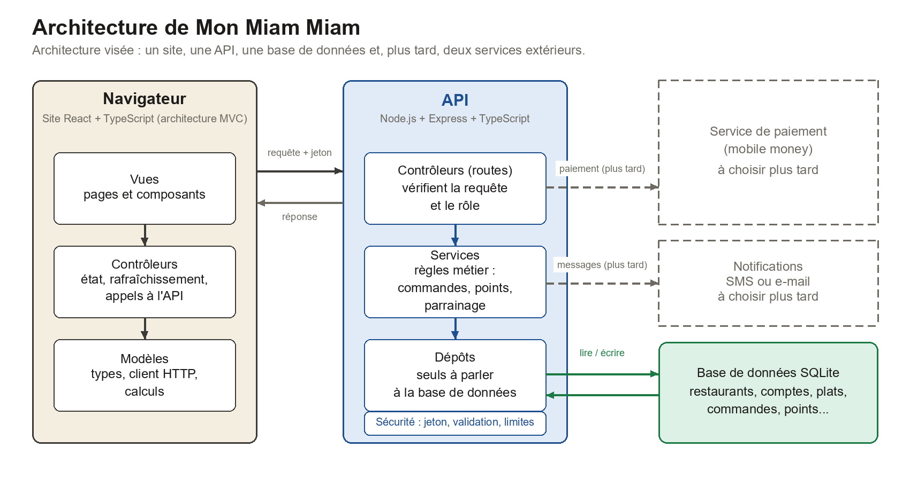

# Architecture technique de Mon Miam Miam

> **État du projet : le dépôt est vide.** Ce document décrit l'architecture **visée** : ce qui sera construit et comment. Tout est écrit au futur. Rien n'existe encore, sauf ce document.

Il décrit les grandes pièces et leurs échanges (partie 1), l'organisation prévue des dossiers (partie 2) et les choix techniques (partie 3). Il sert de référence à toute l'équipe.

## 1. Architecture du site (front-end) et du serveur (back-end)



### Les pièces

| Pièce | Rôle | Technologie prévue |
|---|---|---|
| **Site** (front-end) | Ce que verra l'utilisateur : choix du restaurant, menu, panier, suivi de commande, espaces du personnel. | React, TypeScript, Vite |
| **API** (back-end) | Recevra les demandes du site, appliquera les règles (commandes, points, parrainage, rôles) et répondra en JSON. | Node.js, Express, TypeScript |
| **Base de données** | Gardera les restaurants, comptes, plats, commandes, paiements et points. | SQLite |
| **Service de paiement** | Service extérieur qui encaissera le paiement mobile money. | À choisir plus tard |
| **Notifications** | Envoi de messages (code de réinitialisation, suivi de commande). | SMS ou e-mail, à choisir plus tard |

Le service de paiement et les notifications sont dessinés en pointillés : leur place est prévue, mais ils seront branchés plus tard, sans changer le reste de l'architecture.

### Qui parlera à qui

1. Le **site** enverra une requête à l'**API** (adresses commençant par `/api`) avec, quand l'utilisateur sera connecté, son **jeton** de connexion. L'API répondra en JSON.
2. L'**API** sera la seule à parler à la **base de données**. Le site n'y accédera jamais directement.
3. L'API parlera aux services extérieurs (paiement, notifications) quand ils seront choisis. Une panne d'un de ces services ne devra jamais faire échouer l'opération en cours.

### À l'intérieur du site (architecture MVC)

- **Vues** : les pages et composants. Elles afficheront, mais ne contiendront pas de règles et n'appelleront jamais l'API directement.
- **Contrôleurs** : l'état de l'écran, le rafraîchissement automatique et les appels à l'API. Les vues passeront toujours par eux.
- **Modèles** : les types de données, le client HTTP et les calculs sans écran (formats de montants, panier).

### À l'intérieur de l'API (trois couches)

- **Contrôleurs (routes)** : vérifieront la requête (données valides, rôle autorisé) puis appelleront un service.
- **Services** : porteront les règles métier (commander, cumuler et utiliser des points, parrainer, annuler).
- **Dépôts** : seule couche qui lira et écrira dans la base.

Chaque couche ne parlera qu'à celle d'en dessous. Une règle métier ne sera donc écrite qu'à un seul endroit.

### Plusieurs restaurants, un seul compte

- Un étudiant aura **un seul compte** pour tous les restaurants. Il choisira un restaurant, et le site le gardera en mémoire.
- Chaque demande qui dépend d'un restaurant (menu, commande, points, réclamations) précisera lequel. L'API refusera tout mélange entre deux restaurants.
- Le personnel appartiendra à **un seul** restaurant. L'administration de la plateforme créera et désactivera les restaurants.
- Rôles : étudiant, employé, gérant, administrateur de restaurant, administrateur de la plateforme.
- Personnaliser un restaurant (couleurs, logo, horaires, règles de points) voudra dire **modifier des données** dans la base, jamais modifier le code.

## 2. Organisation prévue des dossiers (structure proposée, à confirmer)

Au départ, le dépôt ne contient que le `README.md`. Voici les dossiers à créer, et ce qu'ils contiendront :

```
mon-miam-miam-projet_integrateur/
├── backend/                  l'API
│   ├── src/
│   │   ├── controllers/      les routes HTTP, une par sujet (commandes, menu, fidélité...)
│   │   ├── services/         les règles métier
│   │   ├── repositories/     l'accès à la base de données
│   │   ├── domain/           les calculs et règles simples, sans base ni réseau
│   │   ├── http/             configuration d'Express, validation, erreurs, sécurité
│   │   ├── db/               ouverture de la base et migrations
│   │   └── main.ts           démarrage du serveur
│   ├── tests/                tests de l'API, rangés par sujet
│   └── .env.example          modèle des variables d'environnement (sans secret)
├── frontend/                 le site
│   └── src/
│       ├── models/           types, client HTTP, calculs
│       ├── controllers/      état et appels à l'API
│       ├── views/            pages (pages/) et composants (components/)
│       └── test/             tests du site
├── database/                 la structure de la base
│   ├── schema.sql            création des tables et contraintes
│   └── donnees-test.sql      données de test
├── docs/                     la documentation (ce fichier, règles, modèle de données...)
└── .github/workflows/        la vérification automatique à chaque envoi de code
```

### Qui écrira où

| Dossier | Responsabilité |
|---|---|
| `database/` | Binôme chargé de la base de données (modèle, tables, contraintes, données de test). |
| `backend/src/` | Binômes chargés de l'API. Un sujet = un contrôleur, un service, un dépôt. |
| `frontend/src/` | Binômes chargés du site. Un écran = une vue, qui s'appuiera sur un contrôleur. |
| `docs/` | Tout le monde, pour ce qu'il a conçu. |

### Règles de nommage et de rangement

- Les **dossiers et fichiers** porteront des noms en minuscules, séparés par des tirets : `staff-accounts.service.ts`.
- Le **code** (noms de variables et de fonctions) sera en anglais ; les **textes affichés** et la **documentation** en français.
- Un fichier de service se terminera par `.service.ts`, un dépôt par `.repo.ts`, un contrôleur par `.controller.ts`.
- Un test sera rangé à côté du sujet qu'il vérifie et portera le numéro de l'histoire Jira dans son titre.
- Aucun secret (mot de passe, clé d'API) dans le dépôt : ils iront dans des variables d'environnement. Le fichier `.env` ne sera jamais publié, seul `.env.example` le sera.
- Les couleurs de l'interface ne seront jamais écrites dans les composants : elles viendront du thème du restaurant.

## 3. Choix techniques

### Technologies prévues

| Sujet | Choix | Pourquoi |
|---|---|---|
| Site | React, TypeScript, Vite | Demandé par le cahier des charges, vérification des types, démarrage rapide. |
| API | Node.js 22 ou plus, TypeScript | Même langage que le site, un seul outil à apprendre pour l'équipe. |
| Framework HTTP | **Express** (confirmé par l'équipe) | Très répandu et bien documenté (il est cité dans les ressources du cahier des charges). Il gère les routes, les erreurs et les protections courantes, pour que l'équipe n'écrive pas à la main ce qu'elle n'a pas besoin de maîtriser. |
| Base de données | SQLite | Simple à installer et à tester. Une migration vers PostgreSQL restera possible grâce à la couche « dépôts ». |
| Connexion | Jeton signé ; mots de passe hachés | Aucun mot de passe stocké en clair, connexion sans session côté serveur. |
| Tests | Test runner de Node pour l'API, Vitest pour le site | Les tests seront écrits avant le code (TDD). |
| Vérification automatique | GitHub Actions | Types et tests lancés à chaque envoi de code et chaque Pull Request. |

> **Décision prise :** Express est le framework du serveur (confirmé par l'équipe). Tout le reste de l'API (couches, validation, erreurs) s'appuie dessus.

### Laissé volontairement pour plus tard

Ces sujets dépendent de comptes ou de décisions qui ne sont pas encore pris. Le reste de l'architecture n'en dépend pas :

- le **service de paiement** mobile money ;
- le fournisseur de **notifications** (SMS ou e-mail) ;
- l'**hébergement** du site et de l'API.

### Conventions de configuration

- Toute la configuration passera par des **variables d'environnement** : port, chemin de la base, secrets, adresse du site autorisée.
- En production, le serveur **refusera de démarrer** si un secret est faible, absent ou égal à la valeur d'exemple.
- Un fichier `.env.example` listera toutes les variables, sans valeur secrète.

### Conventions de données

- Les **montants** seront des entiers en francs congolais (FC), jamais de décimales.
- Les **dates** seront au format ISO 8601 en UTC. Les périodes « jour, semaine, mois » seront calculées en heure de Kinshasa.
- Les **numéros de téléphone** seront enregistrés au format `+243XXXXXXXXX`, même si l'utilisateur les saisit autrement.

### Gestion des erreurs

- Toute erreur de l'API aura la même forme : `{ "error": { "code": "...", "message": "...", "details": [...] } }`. Le `code` ne changera pas, c'est lui que le site utilisera ; le `message` sera en français et lisible par l'utilisateur.
- Statuts HTTP prévus : 400 (données invalides), 401 (non connecté), 403 (interdit), 404 (introuvable), 409 (conflit d'état), 422 (règle métier refusée), 429 (trop de tentatives).
- Une erreur inattendue renverra un simple 500 : le détail technique restera dans les journaux du serveur et ne sera jamais montré à l'utilisateur.
- Une panne d'un service extérieur ne fera jamais échouer l'opération principale.
- Côté site, un message d'erreur de l'API sera affiché tel quel ; une panne de réseau affichera un message dédié.

### Sécurité de base

- Toutes les données reçues seront **validées** avant d'être utilisées.
- Le **rôle** sera vérifié à chaque route protégée.
- Les essais de connexion seront **limités** (par adresse et par compte).
- Un restaurant ne pourra jamais lire ni modifier les données d'un autre.
