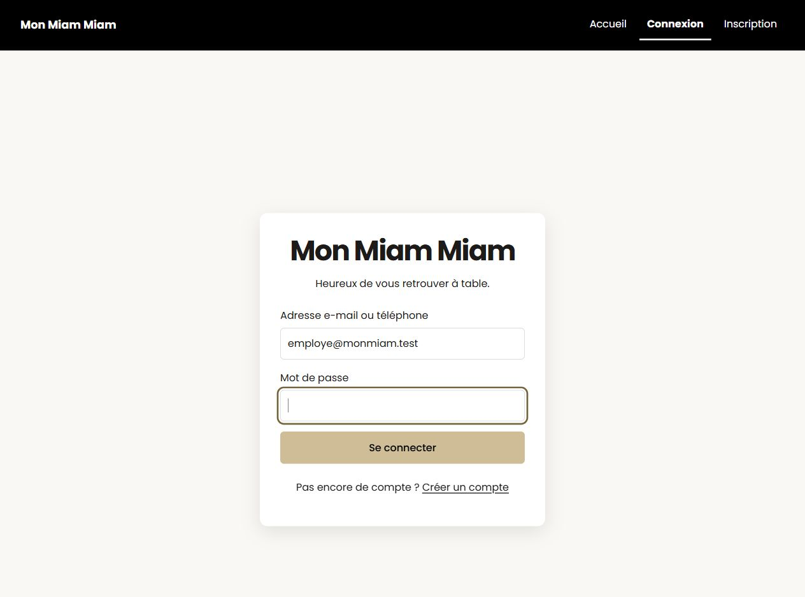
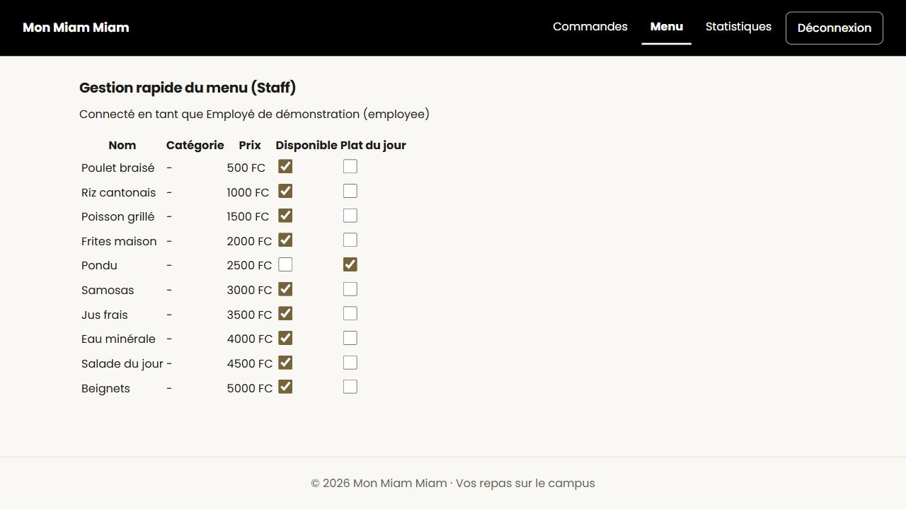
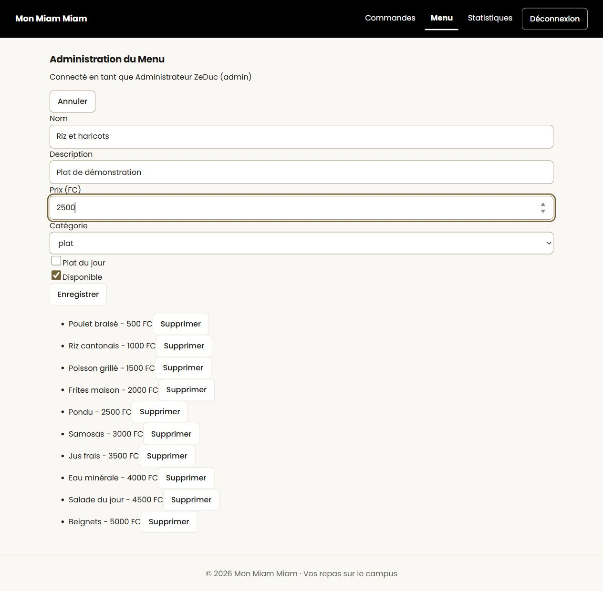
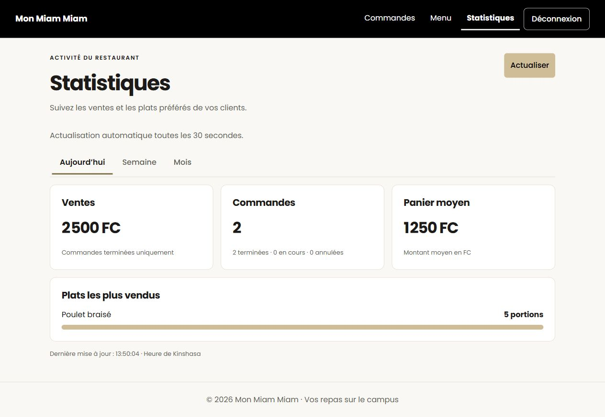

# Guide du personnel — Mon Miam Miam

Version du **3 novembre 2026**. Responsable : Emmanuel Mboyo. Travail E-9, rattaché à [APP-96 — Finaliser le bilan et la documentation](https://judbie2030-45660043.atlassian.net/browse/APP-96).

Ce guide concerne l’employé, le gérant et l’administrateur d’un restaurant. L’administrateur de la plateforme possède un rôle distinct. Chaque compte du personnel intervient uniquement dans le restaurant auquel il est rattaché.

## 1. Ce qui est disponible aujourd’hui

Ce guide décrit `dev` au commit `15e2918`, complété par le [correctif de raccordement des menus, PR #62](https://github.com/alfredoisasole-tech/mon-miam-miam-projet_integrateur/pull/62). Les procédures et captures des menus ci-dessous nécessitent ce correctif : **fusionner #62 avant de présenter ces écrans depuis `dev`**. Les fonctions encore absentes sont indiquées explicitement.

| Fonction | Personnes concernées | État dans l’application |
| --- | --- | --- |
| Connexion et déconnexion | Tout le personnel | Disponibles |
| Bilan du restaurant : jour, semaine, mois | Gérant et administrateur du restaurant | Disponible dans **Statistiques** |
| Statistiques hebdomadaires de l’employé | Employé | Calcul disponible côté serveur ; écran non encore accessible |
| Consultation et avancement des commandes | Employé, gérant, administrateur du restaurant | Traitement disponible côté serveur ; écran du personnel absent |
| Marquer un plat épuisé ou comme plat du jour | Employé, gérant, administrateur du restaurant | Disponible dans **Menu** après intégration de #62 |
| Ajouter ou retirer un plat | Administrateur du restaurant | Disponible dans **Menu** après intégration de #62 |
| Modifier le nom, le prix ou la catégorie d’un plat existant | Administrateur du restaurant | Traitement disponible côté serveur ; formulaire de modification absent |
| Créer des comptes employés | Gérant et administrateur selon les droits prévus | Fonction non encore disponible |
| Créer ou modifier des promotions | Administrateur du restaurant selon les droits prévus | Fonction non encore disponible ; les promotions existantes peuvent être consultées publiquement |

Les droits prévus sont détaillés dans [Rôles et permissions](roles-permissions.md). Le présent guide distingue ces droits des fonctions effectivement accessibles.

## 2. Se connecter et se déconnecter

1. Ouvrez l’application et choisissez **Connexion**. Si nécessaire, ouvrez `/login` sur le même site.
2. Saisissez votre adresse e-mail ou votre numéro de téléphone, puis votre mot de passe.
3. Cliquez sur **Se connecter**.
4. Après une connexion réussie, vous revenez à la page demandée auparavant, ou à l’accueil si aucune page n’avait été demandée.

Demandez votre compte à l’équipe responsable de la démonstration. **Créer un compte** ouvre l’inscription des étudiants : ce formulaire ne crée pas un compte employé, gérant ou administrateur.

Si un message signale des identifiants incorrects, vérifiez les informations saisies. Si le compte est désactivé ou si l’erreur persiste, contactez le responsable du projet. Les données de connexion d’un autre restaurant ne permettent pas d’en gérer les commandes ou les statistiques avec votre compte.

Pour quitter votre session, cliquez sur **Déconnexion**. Sur téléphone, ouvrez d’abord le menu avec le bouton **☰** si les liens sont repliés.

### Capture 1 — Connexion

Formulaire avec l’adresse du compte employé de démonstration, sans mot de passe affiché.

## 3. Employé : commandes et disponibilité des plats

### Commandes

Votre rôle autorise la consultation et l’avancement des commandes de votre restaurant. Toutefois, le lien **Commandes** n’ouvre pas encore un écran de traitement dans cette version : il aboutit à **Page indisponible**.

Il n’existe donc pas encore de procédure utilisable dans l’application pour confirmer une commande, la passer en préparation ou la terminer. Ne considérez pas une commande comme modifiée tant qu’une action n’a pas été enregistrée par une fonction disponible.

### Plat épuisé et plat du jour

1. Cliquez sur **Menu** pour ouvrir `/staff/menu` et l’écran **Gestion rapide du menu (Staff)**.
2. Repérez le plat dans le tableau.
3. Décochez **Disponible** pour signaler un plat épuisé ; cochez la case pour le rendre disponible.
4. Cochez ou décochez **Plat du jour** selon le service prévu.
5. Chaque changement est enregistré immédiatement. Vérifiez l’absence de message d’erreur ; en cas de doute, rechargez la page pour relire l’état enregistré.

L’employé n’a pas le droit de créer, modifier le prix ou supprimer un plat. Le gérant et l’administrateur peuvent également ouvrir `/staff/menu`. Le lien **Menu** de l’administrateur conduit toutefois directement à sa carte, décrite plus bas. La colonne **Catégorie** du menu rapide affiche actuellement un tiret.

### Statistiques de l’employé

Votre rôle est limité aux statistiques hebdomadaires de votre restaurant. L’écran correspondant n’est pas encore accessible. Le bilan global décrit dans la section suivante est réservé au gérant et à l’administrateur du restaurant.

### Capture 2 — Menu rapide du personnel

Après modification et rechargement avec le compte employé de démonstration, **Pondu** est indisponible et marqué comme plat du jour. Les autres plats restent disponibles.

## 4. Gérant : consulter les statistiques

1. Connectez-vous avec votre compte gérant.
2. Cliquez sur **Statistiques**. L’adresse de cet écran est `/staff/overview`.
3. Choisissez **Aujourd’hui**, **Semaine** ou **Mois**.
4. Consultez les tuiles **Ventes**, **Commandes** et **Panier moyen**, puis la liste **Plats les plus vendus**.
5. Pour demander immédiatement une nouvelle lecture, cliquez sur **Actualiser**.

Les chiffres sont actualisés automatiquement toutes les **30 secondes**. L’heure de la dernière mise à jour est affichée en heure de **Kinshasa**. La semaine commence le lundi.

Les ventes concernent les commandes terminées pendant la période. Le compteur **Commandes** concerne les commandes créées pendant cette période : les deux chiffres peuvent donc différer. Le panier moyen est calculé sur les commandes terminées. Les montants sont affichés en FC.

La longueur des barres du classement représente les quantités vendues. Si aucun plat n’a été vendu, la page affiche **Aucune vente sur cette période.**

Lors d’une panne d’actualisation, les anciens chiffres peuvent rester visibles avec un avertissement et leur date. Cliquez sur **Actualiser** pour réessayer. Si l’accès est refusé, les chiffres sont retirés : vérifiez votre connexion et votre rôle.

### Création d’employés

La création et la gestion des employés sont prévues dans les permissions du gérant, mais ne sont pas encore disponibles dans l’application. Aucun bouton **Créer un employé** ni formulaire correspondant ne doit être supposé présent. Pour la démonstration, utilisez les comptes préparés par l’équipe.

## 5. Administrateur du restaurant : carte, promotions et statistiques

### Carte du restaurant

1. Avec un compte administrateur du restaurant, cliquez sur **Menu** pour ouvrir `/admin/menu` et **Administration du Menu**.
2. Cliquez sur **+ Ajouter un plat**.
3. Renseignez **Nom**, **Description**, **Prix (FC)** et **Catégorie** (`plat`, `boisson`, `dessert` ou `snack`). Le nom doit contenir entre 2 et 80 caractères et le prix doit être un entier supérieur ou égal à zéro.
4. Choisissez les états **Plat du jour** et **Disponible**, puis cliquez sur **Enregistrer**. Le formulaire se ferme et le nouveau plat apparaît dans la liste après une création réussie.
5. Pour abandonner la saisie, cliquez sur **Annuler**.
6. Pour retirer un plat, cliquez sur son bouton **Supprimer**, puis confirmez la demande. Vérifiez qu’il a disparu de la liste et qu’aucune erreur n’est affichée.

Le formulaire de modification du nom, du prix ou de la catégorie d’un plat existant n’est pas encore disponible. Pour sa disponibilité et son statut de plat du jour, utilisez `/staff/menu`. Un employé ou un gérant ne peut pas ouvrir la carte d’administration.

### Promotions

La création et la modification des promotions ne sont pas encore disponibles. La consultation publique des promotions existantes ne permet pas de les administrer. Le guide sera complété lorsque les actions correspondantes seront accessibles.

### Statistiques et employés

L’administrateur du restaurant peut utiliser le bilan décrit dans la section **Gérant : consulter les statistiques**. Il voit uniquement les données de son restaurant. La création de comptes employés reste indisponible, comme pour le gérant.

L’administrateur d’un restaurant ne crée pas les autres restaurants et ne change pas leur statut : ces opérations appartiennent à l’administration de la plateforme.

### Capture 3 — Carte de l’administrateur

Le formulaire de création et la liste existante sont affichés avec le compte administrateur de démonstration. **Riz et haricots** est ici un exemple en cours de saisie ; sa création a ensuite été vérifiée avec l’API locale.

### Capture 4 — Statistiques, avec données de démonstration

La capture ci-dessous provient du contrôle local du 3 novembre 2026 avec l’API et une base temporaire : **2 500 FC**, **2 commandes**, un panier moyen de **1 250 FC** et **5 portions**. Ces nombres ne représentent pas l’activité réelle d’un restaurant. Le compte utilisé est un administrateur de restaurant de démonstration ; le gérant est autorisé au même écran.

## 6. Si une page ne fonctionne pas

| Ce que vous voyez | Que faire |
| --- | --- |
| **Page indisponible** après un clic sur **Commandes** | L’écran des commandes du personnel reste absent. Ce n’est pas une confirmation d’action. |
| **Page indisponible** après un clic sur **Menu** | Vérifiez que le correctif #62 est intégré dans la version utilisée. |
| **Impossible de charger le menu** ou erreur après une modification | Vérifiez la connexion et votre rôle ; rechargez pour relire les valeurs enregistrées avant de réessayer. |
| **Impossible de charger les statistiques** | Réessayez avec **Actualiser**. Si le problème continue, signalez-le à l’équipe. |
| Message d’accès refusé | Vérifiez le compte utilisé. Un employé ne peut pas ouvrir le bilan global. |
| Anciennes valeurs avec avertissement | Vérifiez la date affichée ; attendez une actualisation réussie avant d’utiliser ces chiffres. |

## 7. Compléter les captures et tenir le guide à jour

Les quatre captures sont présentes : **connexion**, **menu du personnel**, **carte administrateur**, **statistiques**. Elles ont été prises le **3 novembre 2026**, sur une version locale avec le correctif #62, une API réelle et une base de démonstration temporaire. Aucune donnée d’activité réelle n’y figure.

Utilisez uniquement les comptes de démonstration préparés par l’équipe. Le jeu de démonstration fournit notamment `employe@monmiam.test` et `admin@zeduc-space.test` ; leurs mots de passe sont définis lors de sa préparation et ne sont pas publiés dans ce guide. Un compte gérant doit être fourni séparément : le jeu initial n’en crée pas.

Après chaque évolution, vérifiez les liens, les intitulés des boutons et les droits de chaque rôle avant de modifier les procédures. Faites relire le guide par un membre du personnel qui n’a pas développé l’écran. Cette validation utilisateur reste à obtenir ; les captures ne la remplacent pas.

### Références pour la relecture du guide

- Pages accessibles : [routeur](../frontend/src/App.tsx) et [navigation par rôle](../frontend/src/views/components/Layout.tsx).
- Connexion et retour à la page demandée : [connexion](../frontend/src/views/pages/LoginPage.tsx), [protection des pages](../frontend/src/views/components/RequireRole.tsx).
- Écrans de menu préparés : [personnel](../frontend/src/views/pages/StaffMenuPage.tsx), [administrateur](../frontend/src/views/pages/AdminMenuPage.tsx).
- Statistiques : [écran](../frontend/src/views/pages/StatsPage.tsx), [actualisation et erreurs](../frontend/src/controllers/stats.ts), [contrat API](api/statistiques.md).
- Droits prévus : [rôles et permissions](roles-permissions.md). Comptes de démonstration : [préparation des données](../backend/src/seed.ts).
