# Zoning et wireframes - Mon Miam Miam

Ce dossier présente les parcours prévus pour E-3 : choisir un restaurant, composer une commande, revenir du paiement, traiter les commandes et gérer les restaurants de la plateforme.

- **Responsable :** Emmanuel Mboyo (`emmanuelmboyo-dotcom`).
- **Ticket :** [APP-97 - E-3 : Zoning et wireframes](https://judbie2030-45660043.atlassian.net/browse/APP-97).
- **Planning :** E-3, lundi 26 octobre 2026 ; préparation et vérification achevées le 30 octobre 2026.
- **Branche :** `docs/maquettes-wireframes`, à relire avant fusion dans `dev`.
- **État :** wireframes à relire ; la validation des maquettes et le partage Figma relèvent d’E-4.

## Origine et périmètre

Les wireframes sont redessinés à partir de la maquette fournie dans `Mon Miam Miam.pdf` (32 pages). Le fichier source `Mon Miam Miam.fig` a également été fourni. Ce sont des schémas simplifiés, et non des exports directs des cadres Figma : ils conservent les principales zones de la maquette et remplacent ses photographies par des emplacements neutres.

Le panier complet et les trois retours de paiement sont des compléments proposés pour couvrir E-3 ; leur création a été demandée par Emmanuel. Le mini-panier et la confirmation de changement de restaurant proviennent des pages 2 et 13. Les autres pages de la maquette, notamment l’authentification, les réclamations et le parrainage, ne sont pas reproduites dans ce livrable limité à E-3.

Chaque dessin utilise un cadre de **1 440 × 1 080**, rendu en PNG **2x**, soit **2 880 × 2 160 pixels**. Les dessins restent volontairement en niveaux de gris : la charte, les couleurs et la validation graphique sont prévues dans E-4 et E-5.

Les noms de personnes, téléphones et coordonnées de comptes de la maquette ne sont pas repris. Les références `DEMO-001` à `DEMO-004`, les rôles génériques et l’adresse `admin@example.invalid` sont des données de démonstration. Les sources PDF et FIG ne sont pas ajoutées au dépôt.

## Organisation des zones

| Parcours | Ordre de lecture | Écrans |
| --- | --- | --- |
| Choisir un restaurant | Navigation publique, présentation, cartes de restaurants, promotions | 01 |
| Composer une commande | Identité du restaurant, offre, recherche, catalogue, mini-panier | 02 |
| Confirmer le panier | Articles et quantités, réception, total, fidélité, paiement, confirmation | 03 |
| Revenir du paiement | Résultat, restaurant, référence de commande, montant, prochaine action | 04 à 06 |
| Traiter les commandes | Restaurant, étapes du service, filtres, tableau, prochaine action | 07 |
| Lire les statistiques | Restaurant, période, indicateurs, évolution, classement des plats | 08 |
| Administrer la plateforme | Liste, création, premier administrateur, désactivation ou réactivation | 09 à 12 |
| Changer de restaurant | Conséquence, contenu du panier, annulation ou confirmation | 13 |

## Règles retenues pour les dessins

- Les menus et promotions sont publics ; la confirmation d’une commande exige un compte étudiant.
- Le restaurant reste visible dans le parcours. Un panier contient les articles d’un seul restaurant ; changer de restaurant avec un panier rempli exige une confirmation.
- Le personnel travaille uniquement dans son restaurant. Les écrans de la plateforme sont réservés à son administrateur ; ils ne donnent pas accès aux commandes des restaurants.
- Le panier propose le service sur place ou la livraison et le paiement en espèces ou en ligne. Les montants sont en FC entiers et sont vérifiés par le serveur avant validation.
- Le retour de paiement distingue attente, confirmation et échec ou annulation. La confirmation provient du serveur, jamais uniquement de l’adresse de retour. Le statut du paiement reste distinct de celui de la commande.
- La fidélité reste propre au restaurant : 15 points donnent une remise fixe de 3 000 FC sur les plats. Les retours de paiement n’annoncent pas de gain immédiat de points.
- Désactiver un restaurant bloque les nouvelles commandes sans supprimer son historique. La confirmation nomme le restaurant et présente une action d’annulation.

Références du dépôt : [règles de commande et de paiement](../regles-commande-paiement.md), [rôles et permissions](../roles-permissions.md) et [contrat des commandes](../api/commandes.md).

## Écrans

### 01 - Liste des restaurants

Choisir un restaurant actif depuis l’accueil et accéder à son menu.

Source : PDF p. 1 ; états complémentaires p. 12.

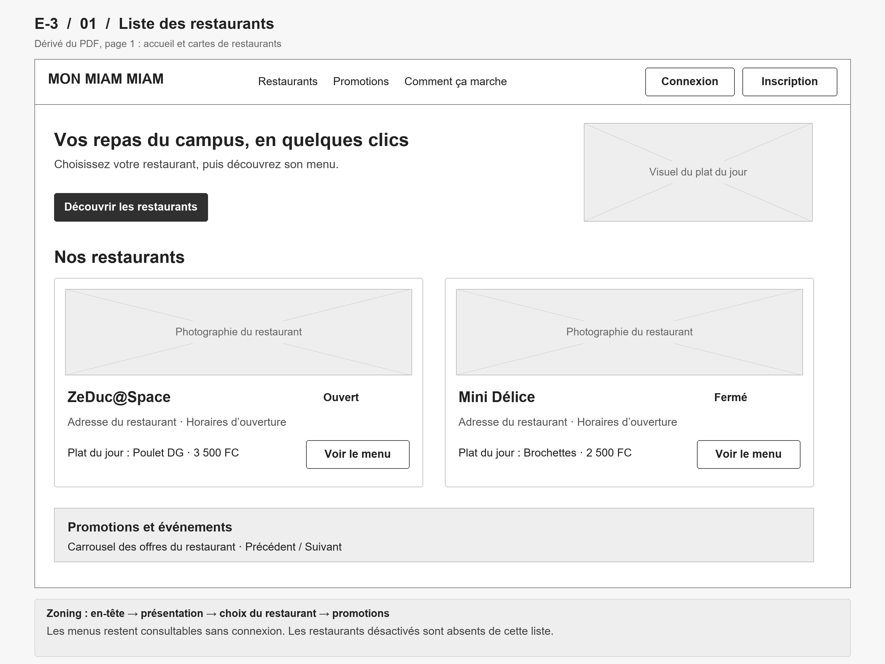

### 02 - Menu du restaurant

Consulter les plats et leur disponibilité, rechercher un article et consulter le panier du restaurant.

Source : PDF p. 2 ; états complémentaires p. 13.

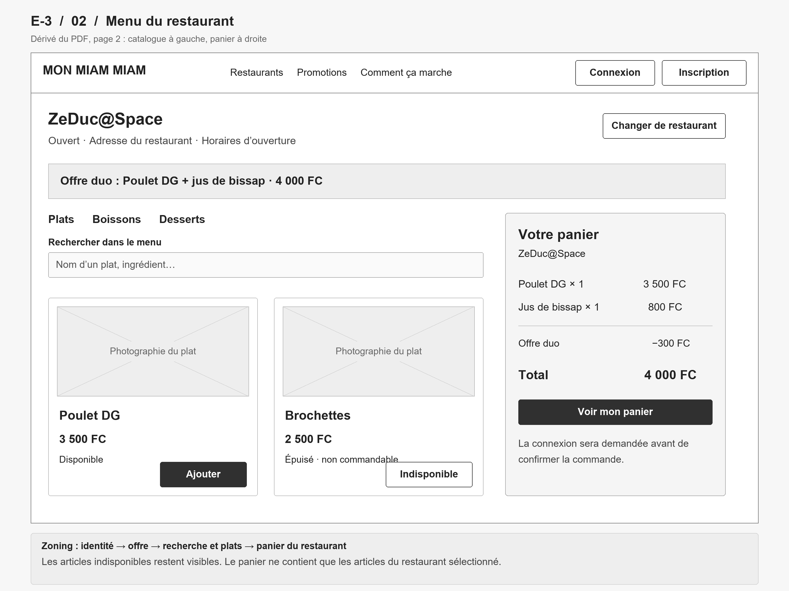

### 03 - Panier et confirmation

Ajuster le panier puis choisir la réception et le paiement avant de confirmer la commande.

Source : complément E-3 fondé sur le mini-panier du PDF p. 2, les états p. 13 et les règles de commande du dépôt.

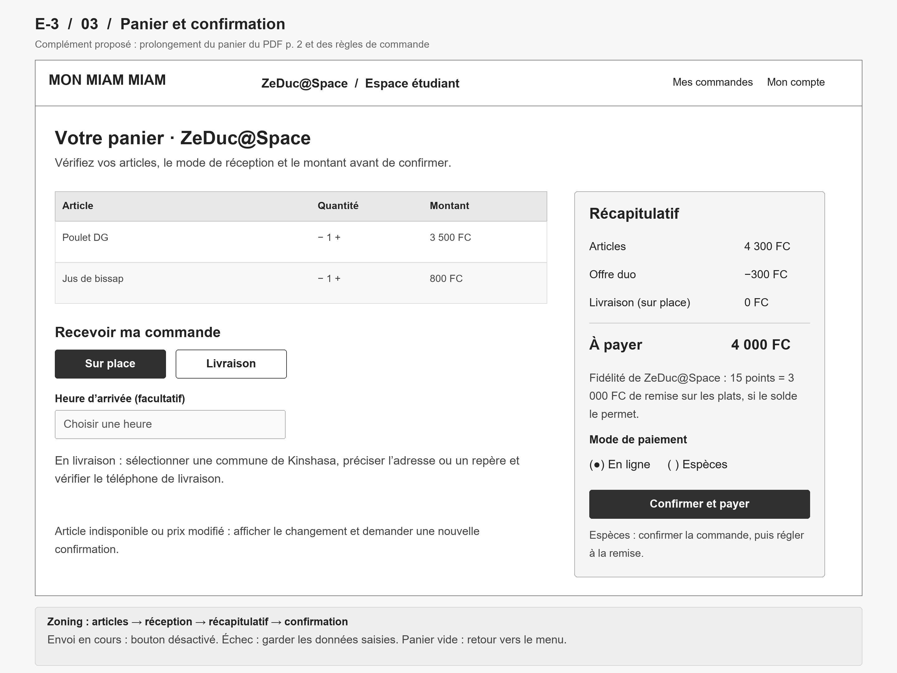

### 04 - Paiement en attente

Afficher un paiement encore en vérification et permettre de consulter la commande sans créer de nouveau paiement.

Source : complément E-3 fondé sur les règles de paiement du dépôt.

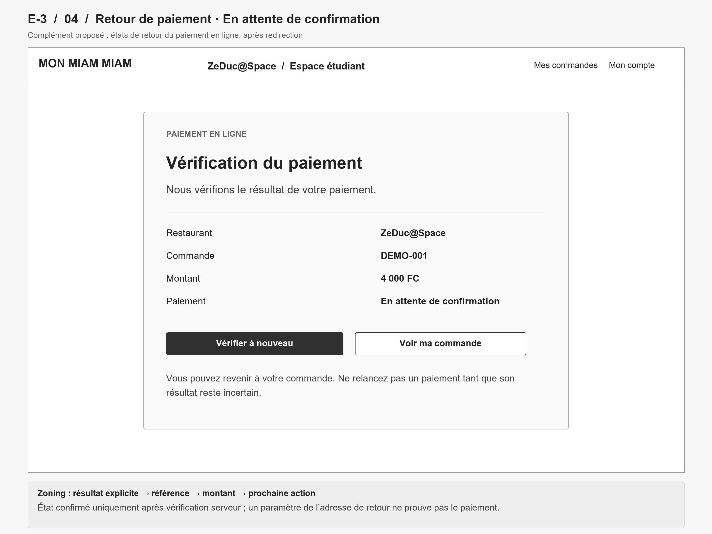

### 05 - Paiement confirmé

Confirmer le paiement vérifié et orienter l’étudiant vers le suivi de sa commande.

Source : complément E-3 fondé sur les règles de paiement du dépôt.

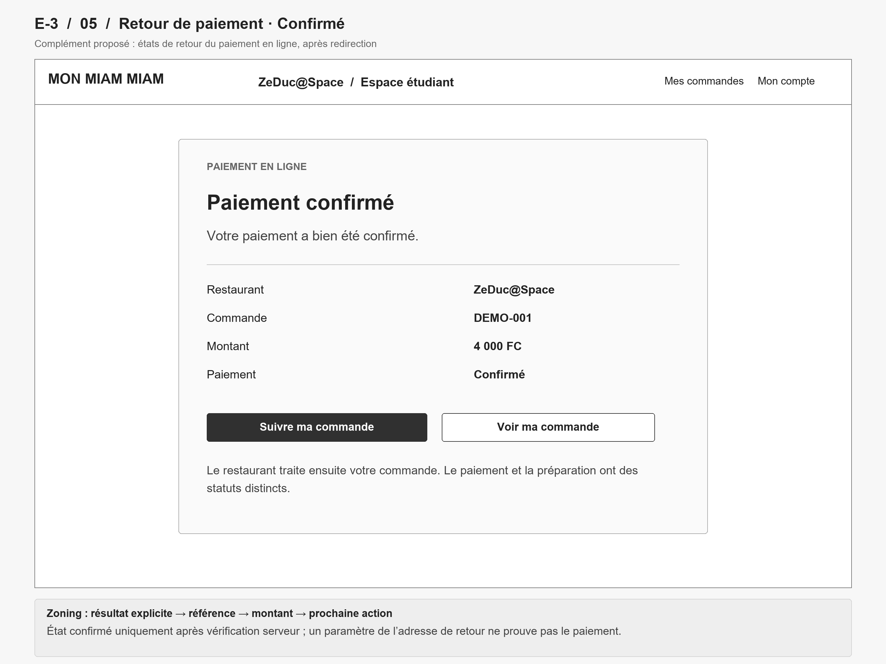

### 06 - Paiement échoué ou annulé

Expliquer un paiement échoué ou annulé et permettre de reprendre le paiement de la même commande.

Source : complément E-3 fondé sur les règles de paiement du dépôt ; le motif précis remplace le libellé générique lorsque le résultat est connu.

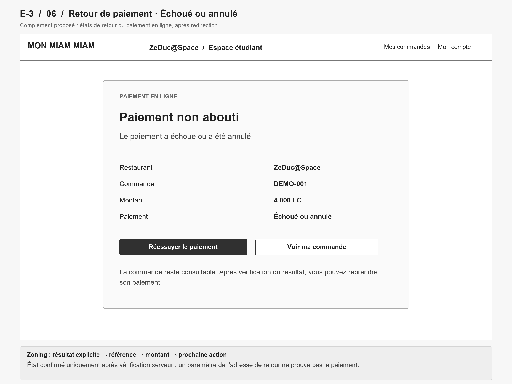

### 07 - Commandes du personnel

Filtrer les commandes du restaurant et ouvrir leur détail en distinguant le statut de commande du paiement.

Source : PDF p. 4 et 5 ; les références de commandes sont fictives.

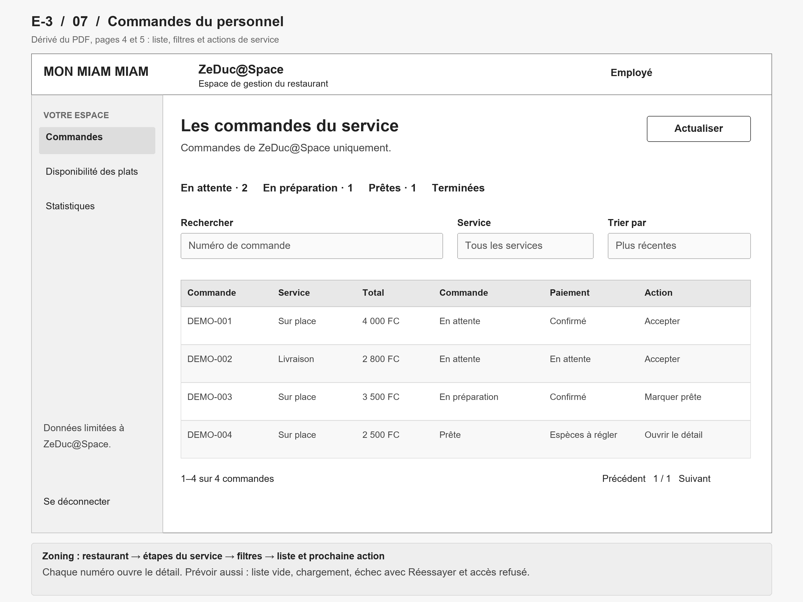

### 08 - Statistiques du restaurant

Lire les indicateurs et l’évolution des ventes du restaurant sur une période choisie.

Source : PDF p. 8 et 19 ; chiffres illustratifs de la maquette, sans données réelles.

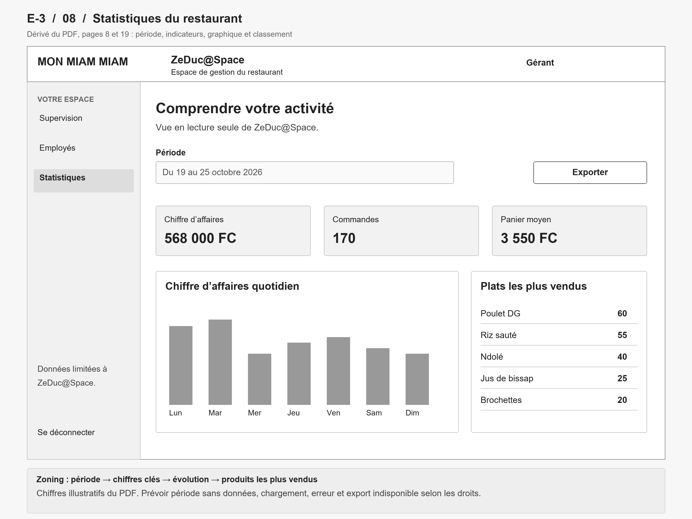

### 09 - Restaurants de la plateforme

Administrer la liste des restaurants et accéder à leur création ou à leur désactivation.

Source : PDF p. 29.

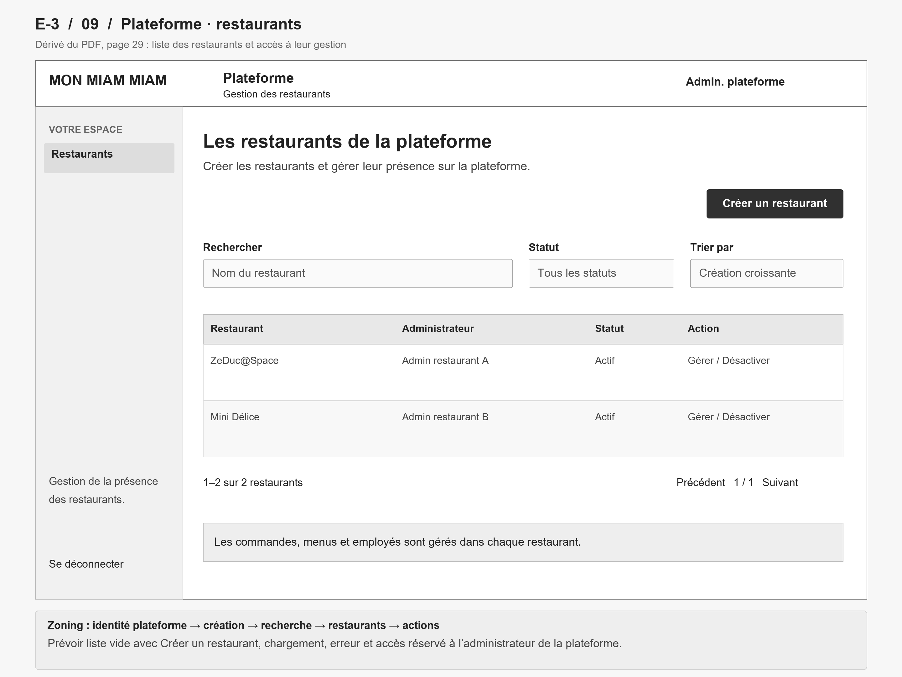

### 10 - Création d’un restaurant

Renseigner l’identité, les coordonnées et les horaires du restaurant avant de désigner son administrateur.

Source : PDF p. 30.

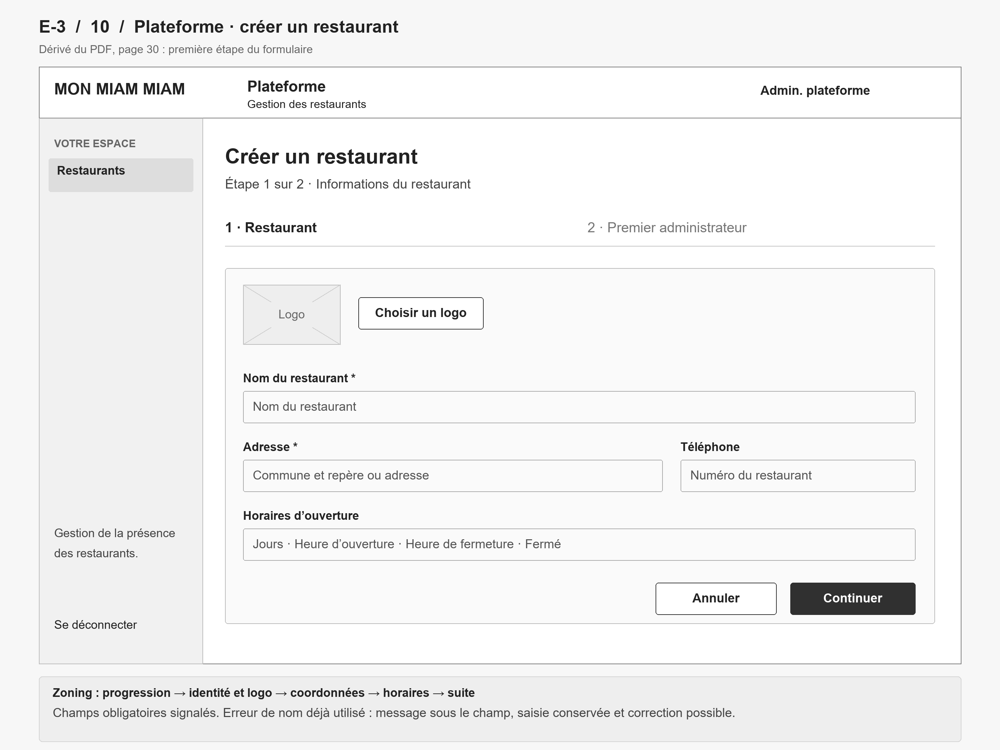

### 11 - Premier administrateur

Associer le premier administrateur au restaurant et vérifier le récapitulatif avant sa création.

Source : PDF p. 31 ; le mécanisme d’invitation reste à valider pour E-4.

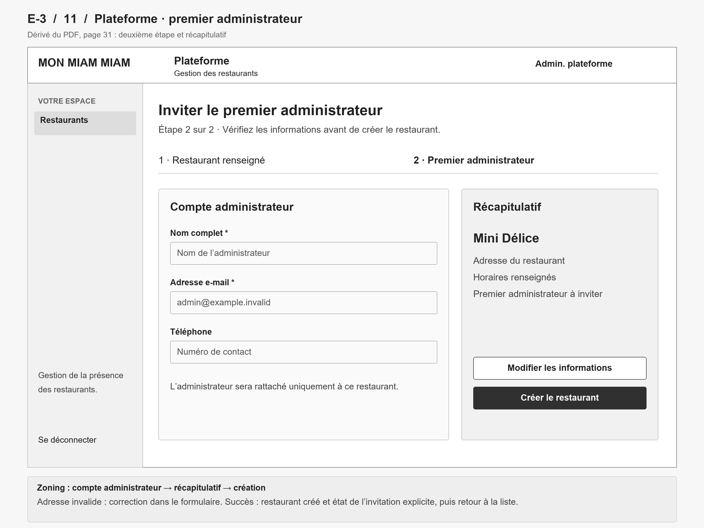

### 12 - Désactivation d’un restaurant

Confirmer la désactivation d’un restaurant en expliquant son effet sur les nouvelles commandes et la conservation de l’historique.

Source : PDF p. 32 et règles multi-restaurants.

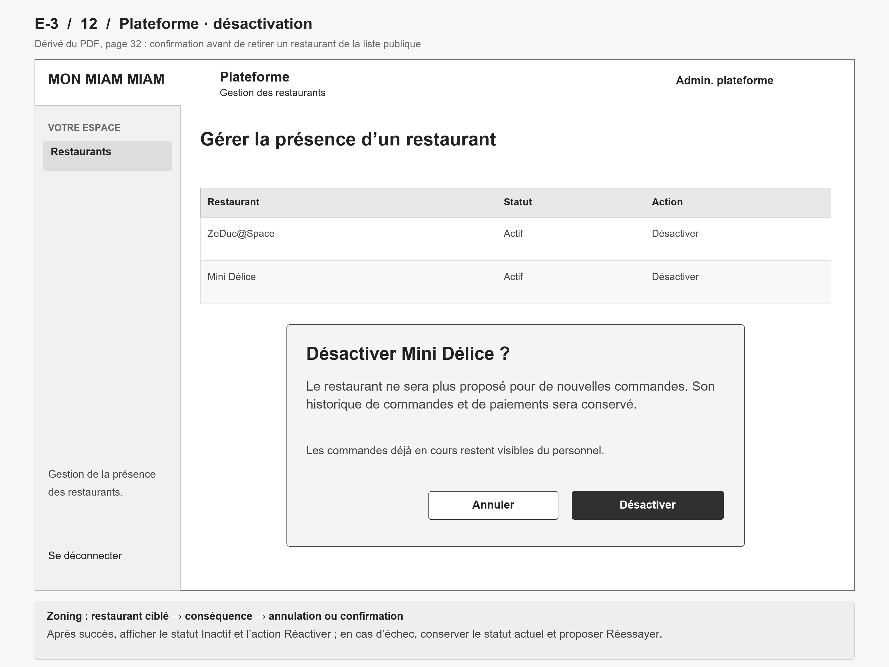

### 13 - Changement de restaurant

Demander confirmation avant de changer de restaurant lorsqu’un panier contient déjà des articles.

Source : PDF p. 13 et règle du panier limité à un restaurant.

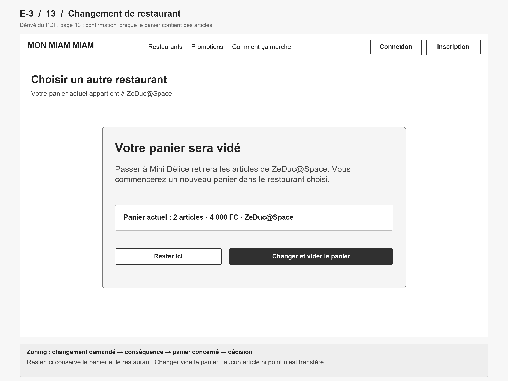

## États et points à valider pour E-4

Les encadrés sous les dessins décrivent les états à décliner : chargement, absence de résultat, erreur avec reprise, accès refusé et envoi en cours. Ils sont des indications de conception, pas des fonctionnalités déjà implémentées.

| Sujet | Observation et traitement dans E-3 |
| --- | --- |
| Fidélité | Le PDF p. 19 évoque une attribution après paiement confirmé ; `docs/regles-commande-paiement.md` prévoit le crédit à la commande terminée. Les dessins n’annoncent aucun crédit au retour du paiement. L’équipe doit confirmer ce moment avant E-4. |
| Arrivée sur place | La maquette contient un délai minimum paramétrable ; le dépôt décrit une heure facultative dans les horaires, au plus 12 h à l’avance. Le panier retient le champ facultatif et n’invente pas de délai minimum. |
| Livraison | Les exemples de contacts et d’adresses du PDF ne sont pas repris ; le formulaire prévoit une commune de Kinshasa, une adresse ou un repère et le téléphone de livraison selon le dépôt. |
| Indicateurs | Les chiffres de l’écran 08 servent uniquement à montrer les zones. Le calcul du chiffre d’affaires, la période et le dénominateur du panier moyen devront correspondre au contrat API. |
| Premier administrateur | La maquette propose une invitation ; l’envoi réel de notifications est hors du noyau prévu. E-4 doit confirmer le mécanisme effectif de création du compte et son retour utilisateur. |
| Rôles | Le PDF présente une supervision du gérant en lecture seule, alors que le tableau de permissions autorise aussi certaines actions de commande. E-3 montre un employé pour le traitement et un gérant pour les statistiques ; l’étendue de la supervision reste à rapprocher des permissions. |
| Validation | Les dessins simplifiés et les compléments du panier et du paiement doivent être relus ; aucune validation du propriétaire ni lien de partage Figma n’est présumé acquis. |

## Vérifications du livrable

- 13 images PNG lisibles, chacune en 2 880 × 2 160 pixels et strictement inférieure à 1 000 000 octets.
- Chaque image possède une phrase de description, une origine identifiée et un lien relatif dans ce README.
- Couverture des sept familles demandées dans E-3, avec trois états de paiement et quatre écrans de plateforme.
- Aucun nom de personne, téléphone réel ou compte personnel repris dans les images ; les exemples sont génériques.
- Relecture visuelle des dessins et contrôle des fichiers effectués localement ; les tests applicatifs ne s’appliquent pas à ces seuls documents.

La relecture croisée du binôme B et les contrôles du dépôt restent nécessaires avant la fusion, conformément aux [conventions Git](../conventions-git.md).
