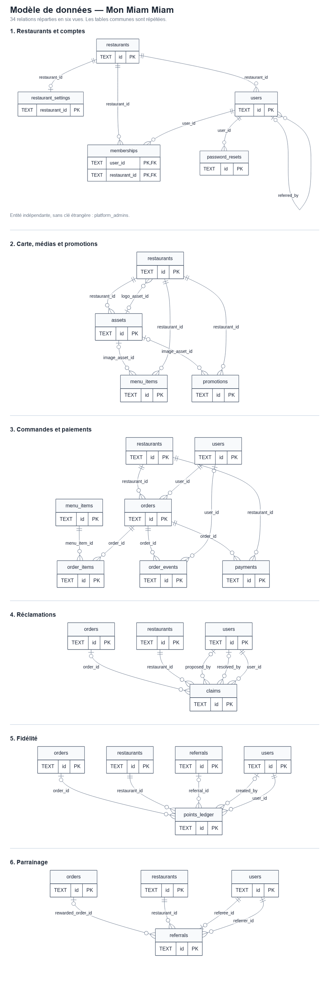
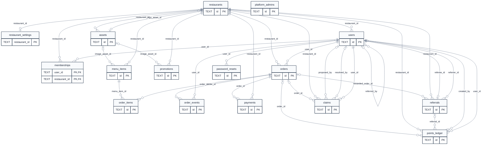

# Modèle de données de Mon Miam Miam

Modèle conçu à partir du cahier des charges et des règles de la plateforme.

Vue synthétique des 34 relations, réparties en six vues. Les détails des clés et des cardinalités suivent. Cliquez sur l'image pour l'ouvrir en pleine taille.

## 1. Entités et attributs

### Conventions

- **Multi-restaurants** : les tables métier portent `restaurant_id` ; les tables « enfants » en héritent par leur table parente.
- **Montants** : entiers en FC (colonnes `*_fc`). **Dates** : texte ISO 8601 en UTC.
- **Identifiants** : `TEXT`. Les booléens sont des `INTEGER` (0 ou 1).
- **Obligatoire** : `oui` = `NOT NULL`. Les valeurs par défaut sont celles du schéma.

### Liste des entités (16)

| Entité | Rôle | Rattachement au restaurant |
|---|---|---|
| `restaurants` | Restaurant : identité visuelle, fuseau horaire et statut. | aucun : c'est le restaurant lui-même |
| `restaurant_settings` | Paramètres d’un restaurant : fidélité, livraison et horaires d’ouverture. Règles de fidélité : 3 000 FC dépensés donnent 1 point ; 15 points donnent une réduction de 3 000 FC. La réduction par défaut est de 3 000 FC. | directe |
| `users` | Comptes des étudiants et du personnel. L’e-mail (sans distinction de casse) et le téléphone sont uniques sur toute la plateforme. | directe |
| `memberships` | Adhésion d’un utilisateur à un restaurant (table d’association) et reliquat de fidélité. | directe |
| `platform_admins` | Administrateurs de la plateforme, hors de tout restaurant. | aucune (plateforme) |
| `menu_items` | Plats et articles de la carte, avec suppression logique (`deleted_at`). | directe |
| `assets` | Fichiers binaires (logos, images) stockés dans la base. | directe |
| `promotions` | Promotions et annonces d’un restaurant, avec période de validité. | directe |
| `orders` | Commandes : type, statut, paiement, montants, points, livraison, avis du client. | directe |
| `order_items` | Lignes d’une commande ; nom, catégorie et prix sont copiés au moment de la commande. | héritée de `menu_items`, `orders` |
| `order_events` | Historique des changements de statut d’une commande. | héritée de `orders`, `users` |
| `payments` | Paiements d’une commande : opérateur mobile, téléphone, montant et statut. | directe |
| `points_ledger` | Journal des points de fidélité ; les crédits sont des lots avec `remaining` et `expires_at`. | directe |
| `referrals` | Parrainages : parrain, filleul, récompense et commande qui l’a déclenchée. | directe |
| `claims` | Réclamations des clients : proposition de décision, puis décision finale. | directe |
| `password_resets` | Demandes de réinitialisation de mot de passe (jeton haché, expiration, utilisation). | héritée de `users` |

### Attributs par entité

#### `restaurants`

Restaurant : identité visuelle, fuseau horaire et statut.

| Attribut | Type | Obligatoire | Défaut | Clé |
|---|---|---|---|---|
| `id` | TEXT | oui |  | PK |
| `slug` | TEXT | oui |  | UNIQUE |
| `name` | TEXT | oui |  |  |
| `tagline` | TEXT | non |  |  |
| `logo_asset_id` | TEXT | non |  | FK → `assets` |
| `primary_color` | TEXT | oui | '#cfbd97' |  |
| `secondary_color` | TEXT | oui | '#000000' |  |
| `font_family` | TEXT | oui |  |  |
| `timezone` | TEXT | oui | 'Africa/Kinshasa' |  |
| `created_at` | TEXT | oui |  |  |
| `default_mode` | TEXT | oui | 'light' |  |
| `status` | TEXT | oui | 'active' |  |

#### `restaurant_settings`

Paramètres d’un restaurant : fidélité, livraison et horaires d’ouverture. Règles de fidélité : 3 000 FC dépensés donnent 1 point ; 15 points donnent une réduction de 3 000 FC. La réduction par défaut est de 3 000 FC.

| Attribut | Type | Obligatoire | Défaut | Clé |
|---|---|---|---|---|
| `restaurant_id` | TEXT | oui |  | PK, FK → `restaurants` |
| `spend_per_point_fc` | INTEGER | oui | 3000 |  |
| `points_per_meal` | INTEGER | oui | 15 |  |
| `free_meal_cap_fc` | INTEGER | oui | 3000 |  |
| `points_validity_months` | INTEGER | oui | 12 |  |
| `delivery_enabled` | INTEGER | oui | 1 |  |
| `delivery_fee_fc` | INTEGER | oui | 0 |  |
| `delivery_communes` | TEXT | oui | '[]' |  |
| `opening_hours` | TEXT | oui |  |  |
| `updated_at` | TEXT | oui |  |  |

#### `users`

Comptes des étudiants et du personnel. L’e-mail (sans distinction de casse) et le téléphone sont uniques sur toute la plateforme.

`restaurant_id` est obligatoire : pour un membre du personnel, il indique son restaurant ; pour un étudiant, son restaurant d’origine. Ses autres restaurants figurent dans `memberships`. Les administrateurs de la plateforme sont enregistrés dans `platform_admins`, hors de tout restaurant.

| Attribut | Type | Obligatoire | Défaut | Clé |
|---|---|---|---|---|
| `id` | TEXT | oui |  | PK |
| `restaurant_id` | TEXT | oui |  | FK → `restaurants` |
| `role` | TEXT | oui |  |  |
| `name` | TEXT | oui |  |  |
| `email` | TEXT | oui |  | UNIQUE globale, sans casse |
| `phone` | TEXT | oui |  | UNIQUE globale |
| `password_hash` | TEXT | oui |  |  |
| `commune` | TEXT | non |  |  |
| `quartier` | TEXT | non |  |  |
| `address` | TEXT | non |  |  |
| `status` | TEXT | oui | 'active' |  |
| `must_change_password` | INTEGER | oui | 0 |  |
| `referral_code` | TEXT | non |  | UNIQUE |
| `referred_by` | TEXT | non |  | FK → `users` |
| `accepted_terms_at` | TEXT | non |  |  |
| `created_at` | TEXT | oui |  |  |
| `last_login_at` | TEXT | non |  |  |

#### `memberships`

Adhésion d’un utilisateur à un restaurant (table d’association) et reliquat de fidélité.

| Attribut | Type | Obligatoire | Défaut | Clé |
|---|---|---|---|---|
| `user_id` | TEXT | oui |  | PK, FK → `users` |
| `restaurant_id` | TEXT | oui |  | PK, FK → `restaurants` |
| `loyalty_remainder_fc` | INTEGER | oui | 0 |  |
| `created_at` | TEXT | oui |  |  |

#### `platform_admins`

Administrateurs de la plateforme, hors de tout restaurant.

| Attribut | Type | Obligatoire | Défaut | Clé |
|---|---|---|---|---|
| `id` | TEXT | oui |  | PK |
| `name` | TEXT | oui |  |  |
| `email` | TEXT | oui |  | UNIQUE |
| `password_hash` | TEXT | oui |  |  |
| `status` | TEXT | oui | 'active' |  |
| `created_at` | TEXT | oui |  |  |
| `last_login_at` | TEXT | non |  |  |

#### `menu_items`

Plats et articles de la carte, avec suppression logique (`deleted_at`).

| Attribut | Type | Obligatoire | Défaut | Clé |
|---|---|---|---|---|
| `id` | TEXT | oui |  | PK |
| `restaurant_id` | TEXT | oui |  | FK → `restaurants` |
| `name` | TEXT | oui |  |  |
| `description` | TEXT | non |  |  |
| `price_fc` | INTEGER | oui |  |  |
| `category` | TEXT | oui |  |  |
| `is_available` | INTEGER | oui | 1 |  |
| `is_daily` | INTEGER | oui | 0 |  |
| `image_asset_id` | TEXT | non |  | FK → `assets` |
| `position` | INTEGER | oui | 0 |  |
| `deleted_at` | TEXT | non |  |  |
| `created_at` | TEXT | oui |  |  |
| `updated_at` | TEXT | oui |  |  |

#### `assets`

Fichiers binaires (logos, images) stockés dans la base.

| Attribut | Type | Obligatoire | Défaut | Clé |
|---|---|---|---|---|
| `id` | TEXT | oui |  | PK |
| `restaurant_id` | TEXT | oui |  | FK → `restaurants` |
| `kind` | TEXT | oui |  |  |
| `mime` | TEXT | oui |  |  |
| `data` | BLOB | oui |  |  |
| `size` | INTEGER | oui |  |  |
| `created_at` | TEXT | oui |  |  |

#### `promotions`

Promotions et annonces d’un restaurant, avec période de validité.

| Attribut | Type | Obligatoire | Défaut | Clé |
|---|---|---|---|---|
| `id` | TEXT | oui |  | PK |
| `restaurant_id` | TEXT | oui |  | FK → `restaurants` |
| `kind` | TEXT | oui |  |  |
| `title` | TEXT | oui |  |  |
| `description` | TEXT | non |  |  |
| `image_asset_id` | TEXT | non |  | FK → `assets` |
| `starts_at` | TEXT | oui |  |  |
| `ends_at` | TEXT | oui |  |  |
| `is_active` | INTEGER | oui | 1 |  |
| `created_at` | TEXT | oui |  |  |
| `updated_at` | TEXT | oui |  |  |

#### `orders`

Commandes : type, statut, paiement, montants, points, livraison, avis du client.

| Attribut | Type | Obligatoire | Défaut | Clé |
|---|---|---|---|---|
| `id` | TEXT | oui |  | PK |
| `restaurant_id` | TEXT | oui |  | FK → `restaurants` |
| `user_id` | TEXT | oui |  | FK → `users` |
| `order_number` | TEXT | oui |  | UNIQUE avec `restaurant_id` |
| `type` | TEXT | oui |  |  |
| `status` | TEXT | oui |  |  |
| `payment_method` | TEXT | oui |  |  |
| `payment_status` | TEXT | oui |  |  |
| `subtotal_fc` | INTEGER | oui |  |  |
| `discount_fc` | INTEGER | oui |  |  |
| `delivery_fee_fc` | INTEGER | oui |  |  |
| `total_fc` | INTEGER | oui |  |  |
| `points_redeemed` | INTEGER | oui | 0 |  |
| `points_earned` | INTEGER | oui | 0 |  |
| `arrival_time` | TEXT | non |  |  |
| `delivery_commune` | TEXT | non |  |  |
| `delivery_quartier` | TEXT | non |  |  |
| `delivery_address` | TEXT | non |  |  |
| `delivery_landmark` | TEXT | non |  |  |
| `delivery_phone` | TEXT | non |  |  |
| `note` | TEXT | non |  |  |
| `idempotency_key` | TEXT | non |  | UNIQUE avec `user_id` |
| `comment` | TEXT | non |  |  |
| `rating` | INTEGER | non |  |  |
| `commented_at` | TEXT | non |  |  |
| `created_at` | TEXT | oui |  |  |
| `updated_at` | TEXT | oui |  |  |
| `completed_at` | TEXT | non |  |  |
| `cancelled_at` | TEXT | non |  |  |

#### `order_items`

Lignes d’une commande ; nom, catégorie et prix sont copiés au moment de la commande.

| Attribut | Type | Obligatoire | Défaut | Clé |
|---|---|---|---|---|
| `id` | TEXT | oui |  | PK |
| `order_id` | TEXT | oui |  | FK → `orders` |
| `menu_item_id` | TEXT | oui |  | FK → `menu_items` |
| `name` | TEXT | oui |  |  |
| `category` | TEXT | oui |  |  |
| `unit_price_fc` | INTEGER | oui |  |  |
| `quantity` | INTEGER | oui |  |  |
| `line_total_fc` | INTEGER | oui |  |  |

#### `order_events`

Historique des changements de statut d’une commande.

| Attribut | Type | Obligatoire | Défaut | Clé |
|---|---|---|---|---|
| `id` | TEXT | oui |  | PK |
| `order_id` | TEXT | oui |  | FK → `orders` |
| `status` | TEXT | oui |  |  |
| `user_id` | TEXT | non |  | FK → `users` |
| `created_at` | TEXT | oui |  |  |

#### `payments`

Paiements mobiles d’une commande (opérateur, téléphone, montant, statut).

| Attribut | Type | Obligatoire | Défaut | Clé |
|---|---|---|---|---|
| `id` | TEXT | oui |  | PK |
| `restaurant_id` | TEXT | oui |  | FK → `restaurants` |
| `order_id` | TEXT | oui |  | FK → `orders` |
| `operator` | TEXT | oui |  |  |
| `phone` | TEXT | oui |  |  |
| `amount_fc` | INTEGER | oui |  |  |
| `status` | TEXT | oui |  |  |
| `provider_ref` | TEXT | non |  |  |
| `created_at` | TEXT | oui |  |  |
| `updated_at` | TEXT | oui |  |  |

#### `points_ledger`

Journal des points de fidélité ; les crédits sont des lots avec `remaining` et `expires_at`.

| Attribut | Type | Obligatoire | Défaut | Clé |
|---|---|---|---|---|
| `id` | TEXT | oui |  | PK |
| `restaurant_id` | TEXT | oui |  | FK → `restaurants` |
| `user_id` | TEXT | oui |  | FK → `users` |
| `kind` | TEXT | oui |  |  |
| `points` | INTEGER | oui |  |  |
| `remaining` | INTEGER | non |  |  |
| `expires_at` | TEXT | non |  |  |
| `order_id` | TEXT | non |  | FK → `orders` |
| `referral_id` | TEXT | non |  | FK → `referrals` |
| `note` | TEXT | non |  |  |
| `created_by` | TEXT | non |  | FK → `users` |
| `created_at` | TEXT | oui |  |  |

#### `referrals`

Parrainages : parrain, filleul, récompense et commande qui l’a déclenchée.

| Attribut | Type | Obligatoire | Défaut | Clé |
|---|---|---|---|---|
| `id` | TEXT | oui |  | PK |
| `restaurant_id` | TEXT | oui |  | FK → `restaurants` |
| `referrer_id` | TEXT | oui |  | FK → `users` |
| `referee_id` | TEXT | oui |  | FK → `users`, UNIQUE |
| `status` | TEXT | oui | 'pending' |  |
| `reward_points` | INTEGER | oui | 0 |  |
| `rewarded_order_id` | TEXT | non |  | FK → `orders` |
| `created_at` | TEXT | oui |  |  |
| `rewarded_at` | TEXT | non |  |  |

#### `claims`

Réclamations des clients : proposition de décision, puis décision finale.

| Attribut | Type | Obligatoire | Défaut | Clé |
|---|---|---|---|---|
| `id` | TEXT | oui |  | PK |
| `restaurant_id` | TEXT | oui |  | FK → `restaurants` |
| `user_id` | TEXT | oui |  | FK → `users` |
| `order_id` | TEXT | non |  | FK → `orders` |
| `kind` | TEXT | oui |  |  |
| `subject` | TEXT | oui |  |  |
| `message` | TEXT | oui |  |  |
| `requested_points` | INTEGER | non |  |  |
| `status` | TEXT | oui | 'open' |  |
| `proposed_decision` | TEXT | non |  |  |
| `proposed_response` | TEXT | non |  |  |
| `proposed_by` | TEXT | non |  | FK → `users` |
| `decision` | TEXT | non |  |  |
| `response` | TEXT | non |  |  |
| `resolved_by` | TEXT | non |  | FK → `users` |
| `manager_note` | TEXT | non |  |  |
| `created_at` | TEXT | oui |  |  |
| `updated_at` | TEXT | oui |  |  |
| `resolved_at` | TEXT | non |  |  |

#### `password_resets`

Demandes de réinitialisation de mot de passe (jeton haché, expiration, utilisation).

| Attribut | Type | Obligatoire | Défaut | Clé |
|---|---|---|---|---|
| `id` | TEXT | oui |  | PK |
| `user_id` | TEXT | oui |  | FK → `users` |
| `token_hash` | TEXT | oui |  | UNIQUE |
| `expires_at` | TEXT | oui |  |  |
| `used_at` | TEXT | non |  |  |
| `created_at` | TEXT | oui |  |  |

## 2. Relations et cardinalités

Le modèle relie les **16 entités par 34 clés étrangères** : les 30 relations principales et quatre relations d’image ou de parrainage ajoutées ci-dessous. Les liens facultatifs sont indiqués par une cardinalité « 0..1 ».

### Diagramme

### Liste des 34 relations

| # | Parent | Enfant | Clé étrangère | Cardinalité (parent – enfant) |
|---|---|---|---|---|
| 1 | `menu_items` | `order_items` | `order_items.menu_item_id` | 1 – 0..N |
| 2 | `orders` | `claims` | `claims.order_id` | 0..1 – 0..N |
| 3 | `orders` | `order_events` | `order_events.order_id` | 1 – 0..N |
| 4 | `orders` | `order_items` | `order_items.order_id` | 1 – 0..N |
| 5 | `orders` | `payments` | `payments.order_id` | 1 – 0..N |
| 6 | `orders` | `points_ledger` | `points_ledger.order_id` | 0..1 – 0..N |
| 7 | `orders` | `referrals` | `referrals.rewarded_order_id` | 0..1 – 0..N |
| 8 | `assets` | `restaurants` | `restaurants.logo_asset_id` | 0..1 – 0..N |
| 9 | `assets` | `menu_items` | `menu_items.image_asset_id` | 0..1 – 0..N |
| 10 | `assets` | `promotions` | `promotions.image_asset_id` | 0..1 – 0..N |
| 11 | `restaurants` | `assets` | `assets.restaurant_id` | 1 – 0..N |
| 12 | `restaurants` | `claims` | `claims.restaurant_id` | 1 – 0..N |
| 13 | `restaurants` | `memberships` | `memberships.restaurant_id` | 1 – 0..N |
| 14 | `restaurants` | `menu_items` | `menu_items.restaurant_id` | 1 – 0..N |
| 15 | `restaurants` | `orders` | `orders.restaurant_id` | 1 – 0..N |
| 16 | `restaurants` | `payments` | `payments.restaurant_id` | 1 – 0..N |
| 17 | `restaurants` | `points_ledger` | `points_ledger.restaurant_id` | 1 – 0..N |
| 18 | `restaurants` | `promotions` | `promotions.restaurant_id` | 1 – 0..N |
| 19 | `restaurants` | `referrals` | `referrals.restaurant_id` | 1 – 0..N |
| 20 | `restaurants` | `restaurant_settings` | `restaurant_settings.restaurant_id` | 1 – 0..1 |
| 21 | `restaurants` | `users` | `users.restaurant_id` | 1 – 0..N |
| 22 | `referrals` | `points_ledger` | `points_ledger.referral_id` | 0..1 – 0..N |
| 23 | `users` | `claims` | `claims.proposed_by` | 0..1 – 0..N |
| 24 | `users` | `claims` | `claims.resolved_by` | 0..1 – 0..N |
| 25 | `users` | `claims` | `claims.user_id` | 1 – 0..N |
| 26 | `users` | `memberships` | `memberships.user_id` | 1 – 0..N |
| 27 | `users` | `order_events` | `order_events.user_id` | 0..1 – 0..N |
| 28 | `users` | `orders` | `orders.user_id` | 1 – 0..N |
| 29 | `users` | `password_resets` | `password_resets.user_id` | 1 – 0..N |
| 30 | `users` | `points_ledger` | `points_ledger.created_by` | 0..1 – 0..N |
| 31 | `users` | `points_ledger` | `points_ledger.user_id` | 1 – 0..N |
| 32 | `users` | `referrals` | `referrals.referee_id` | 1 – 0..1 |
| 33 | `users` | `referrals` | `referrals.referrer_id` | 1 – 0..N |
| 34 | `users` | `users` | `users.referred_by` | 0..1 – 0..N |

### Cas particuliers

- **`memberships`** : association plusieurs-à-plusieurs entre `users` et `restaurants`. Sa clé primaire est composée de `user_id` et `restaurant_id`; elle porte le reliquat de fidélité propre à l'adhésion.
- **`restaurant_settings`** : chaque ligne appartient à un restaurant et un restaurant peut avoir zéro ou une ligne de paramètres ; sa clé primaire est aussi sa clé étrangère.
- **Images** : `restaurants.logo_asset_id`, `menu_items.image_asset_id` et `promotions.image_asset_id` référencent `assets.id`.
- **Parrainage** : `points_ledger.referral_id` référence `referrals.id`; `users.referred_by` est une relation réflexive et `referrals` relie deux utilisateurs distincts par `referrer_id` et `referee_id`.
- **Réclamations** : `claims.user_id` est obligatoire ; `order_id`, `proposed_by` et `resolved_by` sont facultatifs.
- **Liens facultatifs** : `claims.order_id`, `claims.proposed_by`, `claims.resolved_by`, `order_events.user_id`, `points_ledger.order_id`, `points_ledger.referral_id`, `points_ledger.created_by`, `referrals.rewarded_order_id`, `users.referred_by`, ainsi que les trois références d'image vers `assets`.
- **Cohérence entre restaurants** : toute commande, tout paiement, toute réclamation et toute ligne du journal de points doit appartenir au même restaurant que son parent. Cette règle est garantie par des tests automatisés couvrant les clés parentales et l'adhésion de l'étudiant au restaurant ; le seul `users.restaurant_id` ne suffit pas puisqu'il désigne le restaurant d'origine et que `memberships` autorise plusieurs restaurants.
- **Administrateurs de plateforme** : `platform_admins` n'est rattachée à aucun restaurant.

## 3. Validation des clés, des contraintes et de la cohérence

Le modèle a été vérifié entre ses trois sections : les entités, les relations et les contraintes ci-dessous décrivent le même ensemble de 16 tables.

### Contrôles réussis

- [x] Les 16 entités et leurs attributs sont décrits.
- [x] Les **34 clés étrangères** figurent dans le tableau et le diagramme ; les quatre relations ajoutées couvrent les trois références d'image et le lien de parrainage du journal de points.
- [x] Chaque entité possède la clé primaire indiquée ci-dessous.
- [x] Les montants sont exprimés en entiers FC ; les dates sont des textes ISO 8601 en UTC ; les booléens sont des entiers 0 ou 1.
- [x] Le reliquat de fidélité est porté uniquement par `memberships`. `users.restaurant_id` désigne le restaurant d'origine de l'étudiant ou le restaurant de travail du personnel.
- [x] L'e-mail et le téléphone des utilisateurs sont uniques sur toute la plateforme ; l'e-mail ne distingue pas les majuscules des minuscules.
- [x] La réduction de fidélité par défaut est de 3 000 FC, conformément à la règle de 15 points pour 3 000 FC.
- [x] La règle d'appartenance commune entre commande, paiement, réclamation, journal de points et leur restaurant parent est définie et sera couverte par des tests automatisés.

### Clés primaires

- `id` est la clé primaire de chaque table, sauf :
  - `memberships` : clé composée `(user_id, restaurant_id)` ;
  - `restaurant_settings` : `restaurant_id`.

### Contraintes d'unicité

- `restaurants.slug`.
- `users.email` sans distinction de casse, unique sur toute la plateforme.
- `users.phone`, unique sur toute la plateforme.
- `users.referral_code`.
- `orders(restaurant_id, order_number)`.
- `orders(user_id, idempotency_key)`.
- `password_resets.token_hash`.
- `referrals.referee_id` : un filleul n'a qu'un seul parrain.
- `platform_admins.email`.

### Valeurs permises

- `users.role` : `student`, `employee`, `manager`, `admin`.
- `users.status` : `active`, `inactive`, `deleted`.
- `orders.type` : `dine_in`, `delivery`.
- `orders.status` : `pending`, `confirmed`, `preparing`, `ready`, `out_for_delivery`, `completed`, `cancelled`.
- `orders.payment_method` : `cash`, `mobile_money`.
- `orders.payment_status` : `unpaid`, `pending`, `paid`, `failed`, `refund_due`.
- `payments.operator` : `mpesa`, `orange_money`, `airtel_money`, `africell_money`.
- `payments.status` : `pending`, `paid`, `failed`.
- `menu_items.category` : `plat`, `boisson`, `dessert`, `snack`.
- `promotions.kind` : `promotion`, `event`, `game`.
- `points_ledger.kind` : `earn`, `referral`, `redeem`, `expire`, `adjust`, `refund`.
- `referrals.status` : `pending`, `rewarded`.
- `claims.kind` : `order`, `points`, `other`.
- `claims.status` : `open`, `pending_validation`, `resolved`.
- `claims.proposed_decision` et `claims.decision` : `accept`, `refuse` lorsque ces colonnes ne sont pas vides.
- `restaurants.status` et `platform_admins.status` : `active`, `inactive`.
- `restaurants.default_mode` : `light`, `dark`, `system`.
- `assets.kind` : `logo`, `poster`, `menu`.
- Les booléens `restaurant_settings.delivery_enabled`, `users.must_change_password`, `menu_items.is_available`, `menu_items.is_daily` et `promotions.is_active` valent `0` ou `1`.

### Contraintes numériques

- Tous les montants en FC sont supérieurs ou égaux à zéro ; `payments.amount_fc` est strictement supérieur à zéro.
- `order_items.quantity` est strictement supérieur à zéro.
- `orders.points_redeemed` et `orders.points_earned` sont supérieurs ou égaux à zéro.
- `orders.rating` est vide ou compris entre 1 et 5.
- `points_ledger.points` est différent de zéro ; `points_ledger.remaining` est vide ou supérieur ou égal à zéro.
- `referrals.reward_points` est supérieur ou égal à zéro.
- `claims.requested_points` est vide ou strictement supérieur à zéro.
- `restaurant_settings.spend_per_point_fc`, `points_per_meal` et `points_validity_months` sont strictement supérieurs à zéro.
- `memberships.loyalty_remainder_fc` est supérieur ou égal à zéro.

### Règles de calcul (tests)

- `order_items.line_total_fc = order_items.unit_price_fc × order_items.quantity`.
- `orders.total_fc = orders.subtotal_fc − orders.discount_fc + orders.delivery_fee_fc`.

Ces calculs sont des règles métier à vérifier par des tests automatisés ; ils ne sont pas présentés comme des contraintes de base de données.

### Points à corriger

Aucun correctif structurel ne reste ouvert dans ce modèle. Les décisions des cinq constats sont intégrées : les références d'image et de parrainage sont déclarées ; le reliquat réside uniquement dans `memberships` ; le rattachement d'origine des utilisateurs est précisé ; la cohérence entre restaurants est confiée à des tests automatisés. La liste définitive des clés, valeurs et règles numériques résout la vérification des contraintes.

### Questions pour l'équipe

1. **Jeux et événements** : le cahier des charges prévoit des prix ou des points supplémentaires. Faut-il ajouter à `promotions` une colonne facultative `reward_points` (entier supérieur ou égal à zéro) et une table `participations` avec `promotion_id`, `user_id`, la date de participation, les points accordés et une clé unique `(promotion_id, user_id)` ?
2. **Paiement** : le cahier des charges prévoit la carte bancaire et le paiement mobile, tandis que `payments.operator` est limité à quatre opérateurs mobiles. Faut-il ajouter `payments.method` (`card`, `mobile_money`) et rendre `operator` facultatif ?

### Conclusion

Le modèle documentaire couvre 16 entités et 34 relations, intègre les décisions sur les rattachements, la fidélité, les comptes uniques et les clés étrangères d'image et de parrainage. Les règles de calcul et de cohérence entre restaurants ont une méthode de validation définie. Les deux questions sur les récompenses de jeux et les moyens de paiement restent à trancher par l'équipe.
