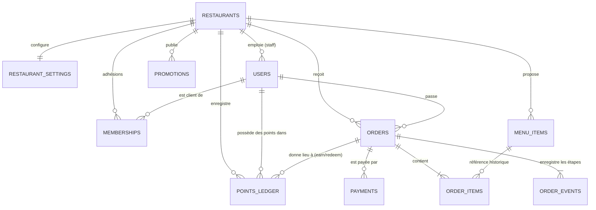

# Modèle de données — Entités, Attributs et Relations (Jira 3.1 & 3.2 / D-1 & D-2)

Ce document est le document de référence du modèle de données prévu par Don (`dondedieuamampakandi-source`), conformément aux fiches **D-1** et **D-2** du plan de reconstruction.

Le document de détail complet avec le schéma détaillé et les 34 relations est accessible dans [modele-de-donnees.md](./modele-de-donnees.md).
La synthèse des 16 entités liée au ticket APP-11 est accessible dans [app-11-modele-de-donnees.md](./app-11-modele-de-donnees.md).

---

## 1. Entités et Attributs (Fiche D-1)

L'application stocke les entités suivantes :

- **`restaurants`** : identifiant unique (`id`), adresse slug unique (`slug`), nom (`name`), slogan (`tagline`), couleurs principale (`primary_color`) et secondaire (`secondary_color`), état (`status` : active/inactive), police (`font_family`), fuseau horaire (`timezone`), date de création (`created_at`).
- **`restaurant_settings`** (réglages du restaurant) : `restaurant_id` (PK, FK), FC dépensés pour 1 point (`spend_per_point_fc` = 3 000), points pour une réduction (`points_per_meal` = 15), valeur max de la réduction (`free_meal_cap_fc` = 3 000 FC), validité des points en mois (`points_validity_months` = 12), livraison activée (`delivery_enabled`), frais de livraison (`delivery_fee_fc`), communes desservies (`delivery_communes`), horaires d'ouverture (`opening_hours`).
- **`platform_admins`** : administrateur de la plateforme (`id`, `name`, `email`, `password_hash`, `auth_version`, `status`, `created_at`).
- **`users`** : compte unique par personne sur toute la plateforme : rôle (`role` : student, employee, manager, admin), `name`, `email` unique (insensible à la casse), `phone` unique normalisé (+243...), `password_hash` (scrypt), `status` (active/inactive), `restaurant_id` (seulement pour le personnel de restaurant, vide/NULL pour un étudiant), `auth_version`, `referral_code`, `referred_by`.
- **`memberships`** : lien étudiant ↔ restaurant (`user_id`, `restaurant_id`, `loyalty_remainder_fc`, `created_at`). Un étudiant peut être client de plusieurs restaurants ; ses points et son reliquat en FC restent strictement isolés par restaurant.
- **`menu_items`** : plats du restaurant (`id`, `restaurant_id`, `name`, `description`, `price_fc`, `category`, `is_available`, `is_daily_special`, `deleted_at`, `created_at`).
- **`promotions`** : affiches, événements et promotions (`id`, `restaurant_id`, `type`, `title`, `description`, `image_url`, `starts_at`, `ends_at`, `is_active`, `created_at`).
- **`orders`** : commandes (`id`, `restaurant_id`, `user_id`, `order_number`, `type`, `status`, `payment_method`, `payment_status`, `subtotal_fc`, `discount_fc`, `delivery_fee_fc`, `total_fc`, `points_redeemed`, `points_earned`, `created_at`).
- **`order_items`** : lignes de commande conservant le prix unitaire d'achat (`id`, `order_id`, `menu_item_id`, `name`, `category`, `unit_price_fc`, `quantity`, `line_total_fc`).
- **`order_events`** : historique d'audit des statuts de commande (`id`, `order_id`, `status`, `user_id`, `created_at`).
- **`payments`** : paiements et simulations (`id`, `order_id`, `restaurant_id`, `amount_fc`, `provider`, `status`, `created_at`).
- **`points_ledger`** : journal des points de fidélité (`id`, `restaurant_id`, `user_id`, `kind`, `points`, `remaining`, `expires_at`, `order_id`, `created_at`).

> **Règle fondamentale** : Montants entiers en Francs Congolais (FC), dates en texte ISO 8601 UTC.

---

## 2. Relations et Cardinalités (Fiche D-2)

### Relations principales expliquées :
1. **Un restaurant a plusieurs plats (`menu_items`)** : chaque plat appartient strictement à un seul restaurant (`restaurant_id`).
2. **Un étudiant a plusieurs adhésions (`memberships`)** : un compte utilisateur unique peut commander dans plusieurs restaurants, mais son adhésion, son solde de points et son reliquat en FC sont strictement compartimentés par restaurant.
3. **Une commande a plusieurs lignes (`order_items`)** : le prix unitaire et la catégorie sont figés à la commande pour garantir l'intégrité comptable.
4. **Une commande a plusieurs paiements possibles (`payments`)** : en cas d'échec ou d'essai répété, chaque tentative est consignée ; une seule validation finale valide la commande.
5. **Un restaurant a plusieurs lignes du journal de points (`points_ledger`)** : les points gagnés dans un restaurant ne sont utilisables que dans ce même restaurant.
